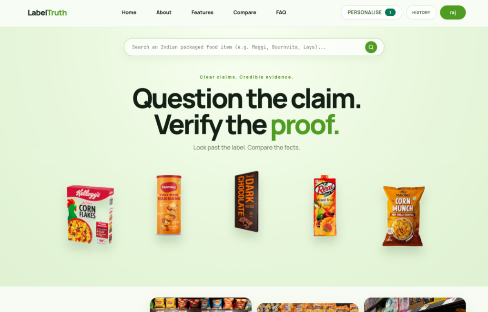
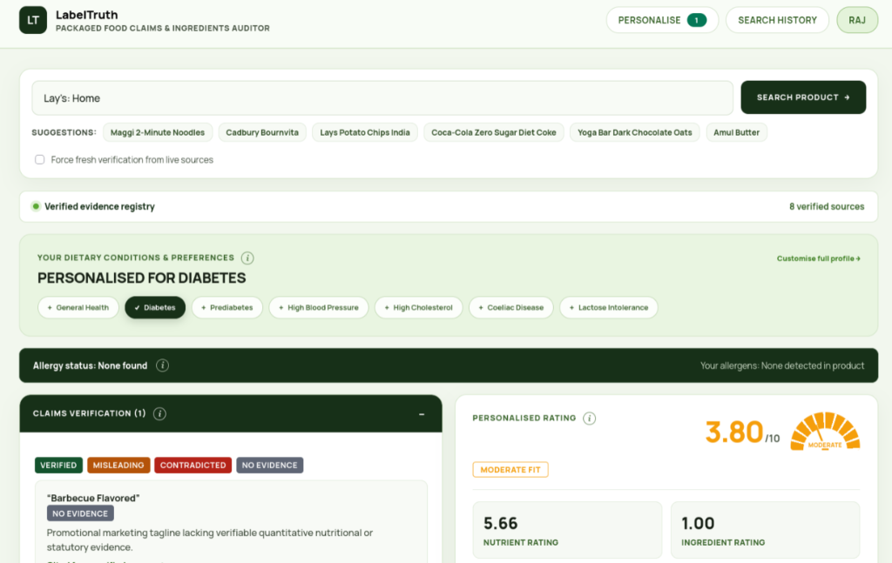
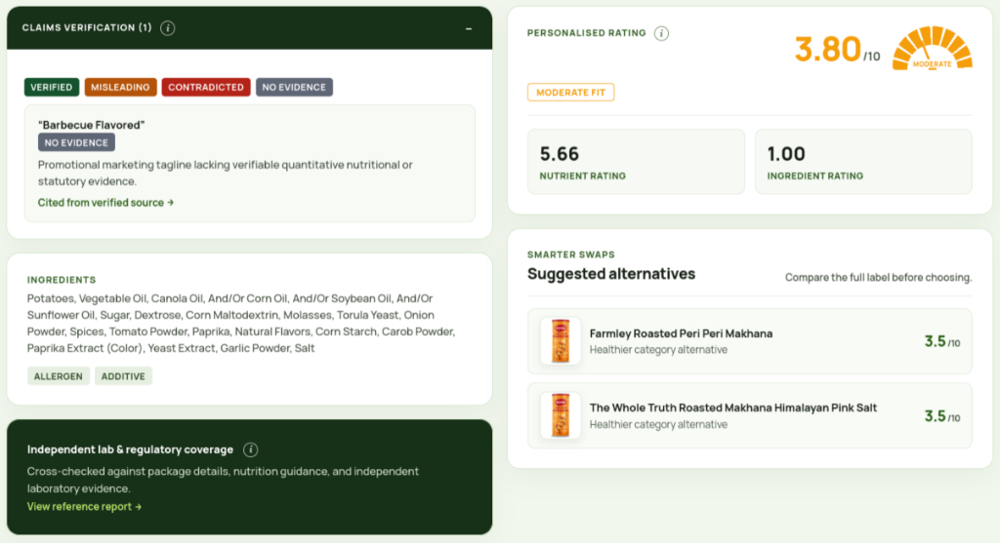
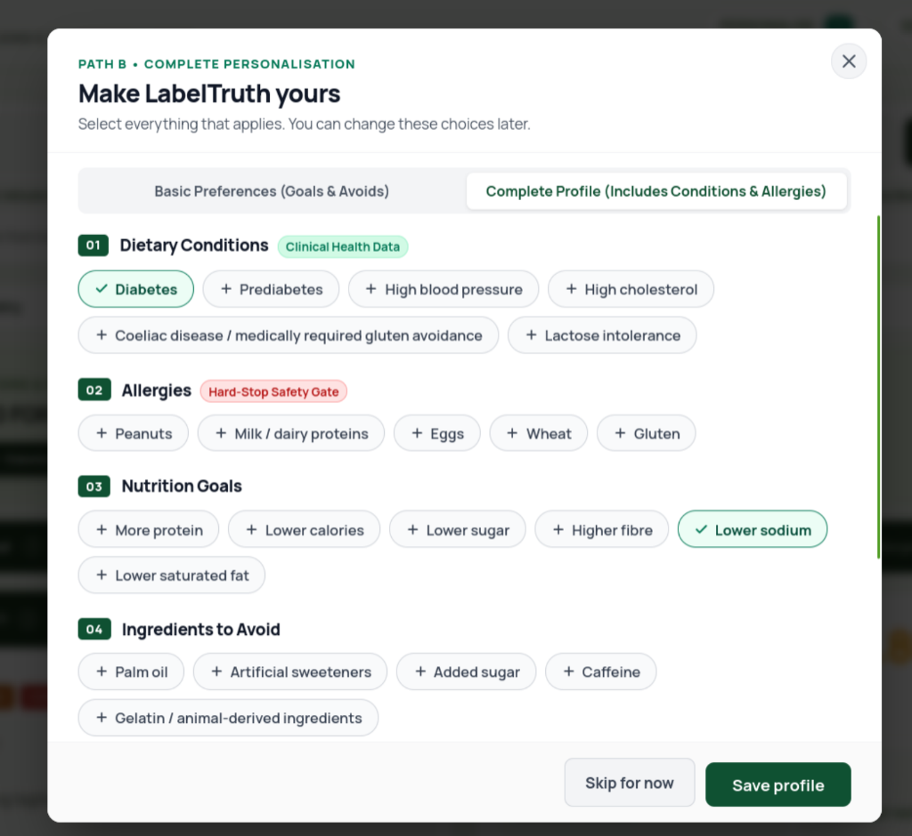
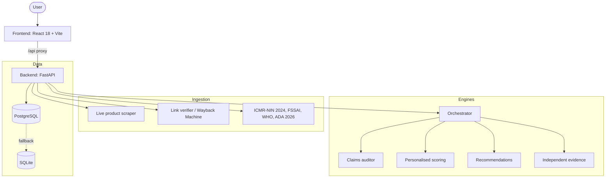

# LabelTruth

*Question the claim. Verify the proof.*

An independent platform that verifies the claims, ingredients, and nutrition of packaged foods sold in India. LabelTruth cross-examines front-of-pack marketing against statutory regulations (FSSAI, ICMR-NIN 2024, WHO, ADA 2026), accredited NABL lab reports, and an individual's dietary and clinical constraints.


---

## Table of contents

- [Overview](#overview)
- [Screenshots](#screenshots)
- [Features](#features)
- [How it works](#how-it-works)
- [Tech stack](#tech-stack)
- [Getting started](#getting-started)
- [User guide](#user-guide)
- [Scoring methodology](#scoring-methodology)
- [Claim verdicts and evidence rules](#claim-verdicts-and-evidence-rules)
- [API reference](#api-reference)
- [Developer guide](#developer-guide)
- [Testing](#testing)
- [Disclaimer](#disclaimer)
- [Contributing](#contributing)
- [License](#license)
- [Acknowledgements](#acknowledgements)

---

## Overview

Front-of-pack claims such as "Immunity & Strength", "No Added Cane Sugar", or "Source of Protein" are easy to make and hard to check. LabelTruth takes a product name, retrieves its label data, and answers three questions:

1. **Is the claim true?** Each claim is classified against FSSAI rules and the product's own nutrition table.
2. **Is the product good for me?** A base score is adjusted for your health conditions, allergies, and goals.
3. **Is there independent proof?** Only regulator actions and accredited lab or consumer-body reports are shown, with every link verified server-side.

---

## Screenshots

### 1. Landing Page & Hero Search
*Clean, consumer-friendly search interface with real-time suggestions and featured product showcase.*



---

### 2. Product Audit & Dietary Personalisation Strip
*Live verified evidence status, condition toggles (e.g. Diabetes, Hypertension), and hard allergen safety checks.*



---

### 3. Claims Verification & Smarter Swaps
*Evidence-backed verdict badges, ingredient statements with additive/allergen flags, personalized rating gauge, and healthier alternatives.*



---

### 4. Complete Personalisation Profile (Path B)
*Granular preferences: clinical dietary conditions, hard-stop allergen safety gates, nutrition goals, and ingredients to avoid.*



---

## Features

**Claim auditing**
- Four-tier verdicts for every front-pack claim: Verified, Misleading, Contradicted, No Evidence.
- Statutory thresholds drawn from FSSAI and ICMR-NIN 2024.

**Scoring**
- Base Health Score (1 to 10, lower is better) from sugar, sodium, saturated fat, protein, fibre, palm oil, and additives.
- Personalised Score adjusted for diabetes, hypertension, cholesterol, dietary goals, and allergens.
- Hard allergen contraindication: a matched allergen forces the worst rating.

**Independent evidence**
- Three evidence tiers: regulator, NABL-accredited lab, independent testing body.
- Domain whitelist and numeric source IDs. The system never generates URLs.
- Every link is checked and labelled reachable, dead, restricted, or error.

**Recommendations**
- Smarter swaps within the same category, with calorie, sugar, and protein comparisons.

**Accounts and personalisation**
- Guest mode, or signed-in profiles with separate consent for health data.
- Saved comparisons and an audit history viewer.

**Engineering**
- Cached audits return in under 50 ms on repeat queries.
- PostgreSQL with automatic SQLite fallback.
- 106 automated tests across backend and frontend.

---

## How it works



The orchestrator coordinates the engines, serves repeat queries from cache, and persists each audit to the evidence log. The frontend never talks to external sources directly; it only consumes the backend `AuditResponse`, normalised by an adapter layer.

---

## Tech stack

| Layer | Technology |
| --- | --- |
| Frontend | React 18, Vite 5, Lucide-React, CSS custom properties |
| Backend | FastAPI, Uvicorn, Pydantic v2, SQLAlchemy (asyncpg / aiosqlite) |
| Database | PostgreSQL 16, SQLite fallback |
| Auth | JWT sessions, PBKDF2/bcrypt password hashing |
| Infrastructure | Docker, Docker Compose, Nginx |
| Testing | pytest, Node built-in test runner |

---

## Getting started

### Prerequisites

- Python 3.14+
- Node.js 18+ and npm
- Docker and Docker Compose (optional, for containerised setup)
- PostgreSQL 16 (optional; SQLite is used automatically if PostgreSQL is unreachable)

### Option 1: Docker Compose

```bash
git clone <repository-url>
cd LabelTruth_CibeVoders_HackIIITD
docker-compose up --build -d
```

| Service | Description | Port |
| --- | --- | --- |
| `db` | PostgreSQL 16 | 5432 |
| `backend` | FastAPI server | 8000 |
| `frontend` | Nginx serving the production build | 80 |

### Option 2: Local development

**Backend**

```bash
cd backend
python3 -m venv venv
source venv/bin/activate
pip install -r requirements.txt

python -m uvicorn app.main:app --app-dir . --host 0.0.0.0 --port 8000 --reload
```

The API is served at `http://localhost:8000`. FastAPI exposes interactive docs at `/docs` by default.

**Frontend**

```bash
cd frontend
npm install
npx vite --host 0.0.0.0 --port 5173
```

The app is served at `http://localhost:5173`. Vite proxies `/api` requests to the backend on port 8000, so start the backend first.

### Configuration

Runtime settings and environment variables are defined in `backend/app/config.py`. Reference data lives in `config/`:

| File | Purpose |
| --- | --- |
| `allowed_domains.json` | Whitelisted domains for lab and regulatory evidence |
| `profile_options.json` | Clinical conditions, allergies, dietary goals, and selection chips |
| `recommendation.json` | Swap criteria and thresholds |
| `source_directory.json` | Verified category browse fallbacks |

`data/lab_reports_seed.json` holds the offline seed set of accredited lab and regulatory test records.

---

## User guide

### Auditing a product

1. Open the landing page and type a product name into the search bar (for example, "Cadbury Bournvita").
2. Review the audit screen:
   - **Needle gauge**: your personalised score, banded from Good fit to Very poor.
   - **Claims**: each front-pack claim with its verdict and the reason. Filter by verdict type.
   - **Ingredients**: pills flag palm oil derivatives, allergens, and additives.
   - **Nutrient breakdown**: labelled values next to ICMR-NIN 2024 daily limits.
   - **Independent evidence**: regulator actions and lab reports, with link status.
   - **Smarter swaps**: healthier alternatives in the same category.
3. Use the formula info icons to inspect exactly how a score was computed.

### Personalising results

Two paths are available from the personalise dialog:

- **Path A, concerned consumer**: choose dietary goals, a diet pattern, and ingredients to avoid. No health data is collected.
- **Path B, clinical profile**: add conditions (diabetes, hypertension, cholesterol) and allergies. This requires explicit, separate consent for health data.

Guests can personalise for the current session. Signed-in users keep their profile across sessions.

### Accounts

Sign up with your name, email, and a password of at least 8 characters, and confirm you are 18 or older and accept the Terms. Password reset uses a 6-digit token. Signed-in users can save comparisons and reopen their audit history.

### Reading the rating bands

| Score | Band | Meaning |
| :---: | --- | --- |
| 1.0 to 3.0 | Good fit | Low risk and aligned with your profile |
| 3.0 to 5.0 | Moderate | Acceptable in moderation, minor flags |
| 5.0 to 7.0 | Poor | High in sugar, fat, or salt, or misaligned with your profile |
| 7.0 to 10.0 | Very poor | Contains an allergen you selected, or extreme sugar, fat, or salt |

---

## Scoring methodology

All nutrient inputs are normalised to per 100 g (or a standard reference serving).

### Base Health Score

Penalties, each capped at 10:

$$P_{\text{sugar}} = \min\left(10, \frac{\max(0, Sugars - 5)}{2.5}\right)$$

$$P_{\text{sodium}} = \min\left(10, \frac{\max(0, Sodium - 100)}{150}\right)$$

$$P_{\text{satfat}} = \min\left(10, \frac{\max(0, SatFat - 1.5)}{1.2}\right)$$

Credit and modifiers:

$$C_{\text{good}} = \min\left(3, \frac{Protein}{5} + \frac{Fiber}{3}\right)$$

$$M_{\text{palm}} = 1.0 + 0.25 \times HasPalmOil$$

$$P_{\text{add}} = \min(2.5, 0.5 \times AdditiveCount)$$

Combined:

$$S_{b,\text{raw}} = \left(0.40 \cdot P_{\text{sugar}} + 0.35 \cdot P_{\text{sodium}} + 0.25 \cdot P_{\text{satfat}}\right) \times M_{\text{palm}} + P_{\text{add}} - C_{\text{good}}$$

$$S_b = \text{clamp}\left(1.0 + 0.9 \times S_{b,\text{raw}},\ 1.0,\ 10.0\right)$$

### Personalised score

$$S_p = \text{clamp}\left(S_b + \sum_{c} \Delta_c + \sum_{g} \Delta_g + \text{AllergenOverride},\ 1.0,\ 10.0\right)$$

| Condition | Adjustment (per serving) |
| --- | --- |
| Diabetes / prediabetes | +3.5 if sugars > 10 g; +2.0 if sugars > 5 g |
| Hypertension | +3.0 if sodium > 400 mg; +1.5 if sodium > 200 mg |
| Cholesterol / heart health | +3.5 if palm oil present or saturated fat > 4 g; +1.5 if saturated fat > 2 g |
| Allergen match | Score forced to 10.0 (severe medical contraindication) |

---

## Claim verdicts and evidence rules

### Verdicts

| Verdict | Meaning | Example |
| --- | --- | --- |
| Verified | Complies with FSSAI rules and is confirmed by the nutrition table or lab data | Zero-sugar claim with no sugars declared |
| Misleading | Technically true but hides other risks or exploits a loophole | "No Added Cane Sugar" with invert syrup in the ingredients |
| Contradicted | Refuted by the nutrition table | "Fat-Free" with 5 g saturated fat |
| No Evidence | Promotional language with no measurable basis | "Made with Love" |

### Evidence tiers

| Tier | Source | Examples |
| --- | --- | --- |
| A | Regulator | FSSAI enforcement notices, recall orders, gazette notifications |
| B | Accredited lab | NABL test reports with lab registration and ISO/IEC 17025 compliance |
| C | Independent testing body | Comparative studies by Consumer Voice India and similar organisations |

### Provenance rules

- URLs are never generated by a model. Each is assigned a numeric `source_id` at ingestion and mapped to retrieved results.
- Only whitelisted domains are accepted: `consumer-voice.org`, `join.consumer-voice.org`, `fssai.gov.in`, `www.fssai.gov.in`, `consumeraffairs.nic.in`, `nin.res.in`.
- Social media and forum sentiment are excluded.

### Link verification

Every URL is checked with HTTP HEAD/GET (10 second timeout, maximum 5 redirects).

| Status | Condition |
| --- | --- |
| `reachable` | 200 OK with content keyword confirmation |
| `dead` | 404, 410, or DNS failure |
| `restricted` | Paywalled or login required; shown with a warning |
| `error` | Timeout or 5xx response |

---

## API reference

Base URL: `http://localhost:8000`

### Endpoints

| Method | Path | Description |
| --- | --- | --- |
| POST | `/api/audit` | Audit a product |
| GET | `/api/profile-options` | Conditions, allergies, goals, and diet patterns |
| POST | `/api/auth/signup` | Register (name, email, password, terms, 18+ confirmation) |
| POST | `/api/auth/login` | Log in; returns a JWT and profile |
| GET | `/api/auth/me` | Validate a session token |
| POST | `/api/auth/forgot-password` | Issue a 6-digit reset token |
| POST | `/api/auth/reset-password` | Set a new password with a reset token |
| POST | `/api/user/profile` | Save personalisation (clinical data needs separate consent) |

See `backend/app/api/routes.py` and `auth_routes.py` for the complete list, including evidence history and saved comparisons.

### `POST /api/audit`

Request:

```json
{
  "query": "Cadbury Bournvita",
  "force_refresh": false,
  "dietary_condition": "diabetes",
  "sugar_threshold_pct": 0.15,
  "user_conditions": ["diabetes", "high_blood_pressure"],
  "user_allergens": ["gluten"],
  "avoid_ingredients": ["palm_oil"],
  "dietary_pattern": "vegetarian",
  "nutrition_goals": ["reduce_sugar"]
}
```

| Field | Description |
| --- | --- |
| `query` | Product name to audit (required) |
| `force_refresh` | Bypass the cache and re-fetch |
| `dietary_condition` | Primary dietary condition |
| `sugar_threshold_pct` | Sugar threshold fraction used for condition checks |
| `user_conditions` | Clinical conditions from `/api/profile-options` |
| `user_allergens` | Allergens to flag as contraindications |
| `avoid_ingredients` | Ingredients to avoid |
| `dietary_pattern` | For example, `vegetarian` |
| `nutrition_goals` | For example, `reduce_sugar` |

Response (abridged):

```json
{
  "query": "Cadbury Bournvita",
  "is_cached": true,
  "evidence_log_id": 42,
  "created_at": "2026-10-25T04:12:00Z",
  "source_urls": ["https://blinkit.com/...", "https://www.fssai.gov.in/..."],
  "data": {
    "product_name": { "value": "Cadbury Bournvita Chocolate Health Drink 500g" },
    "nutrition": {
      "serving_size": { "value": "20g" },
      "sugars_g": { "value": 14.2, "unit": "g" },
      "sodium_mg": { "value": 52.0, "unit": "mg" }
    },
    "front_pack_claims": [
      {
        "claim": "Immunity & Strength",
        "audit_verdict": "MISLEADING",
        "verdict_reason": "High added sugar content offsets micronutrient bioavailability."
      }
    ],
    "independent_evidence": {
      "section_1": {
        "accepted": [{ "record_id": "lab_bv_001", "tier": "A" }],
        "reported_not_verified": []
      }
    },
    "personalized_scoring": {
      "base_score": 7.4,
      "personalized_score": 9.2,
      "rating_band": "Very poor",
      "allergy_alert": false
    },
    "recommendations": [
      {
        "product_name": "Sattu Pure Roasted Gram Drink",
        "match_reason": "Zero added sugar, higher protein, unrefined whole grain.",
        "score_improvement": "+5.8 points"
      }
    ]
  }
}
```

Response fields are abridged for readability. Refer to `backend/app/schemas/audit_schemas.py` for the full schema.

---

## Developer guide

### Project structure

```text
LabelTruth_CibeVoders_HackIIITD/
├── config/                 Reference dictionaries and thresholds
├── data/                   Offline seed datasets (lab reports)
├── backend/
│   ├── app/
│   │   ├── api/            REST routes (audit, evidence, auth)
│   │   ├── services/       Domain engines (see below)
│   │   ├── models/         SQLAlchemy ORM models
│   │   ├── schemas/        Pydantic request/response schemas
│   │   ├── config.py       Settings
│   │   ├── database.py     Connection pool with SQLite fallback
│   │   └── main.py         ASGI app factory and CORS
│   ├── tests/              pytest suite
│   ├── Dockerfile
│   └── requirements.txt
├── frontend/
│   ├── src/
│   │   ├── components/     UI components
│   │   ├── context/        AuthContext
│   │   ├── services/       API client
│   │   ├── utils/          figmaAdapter, themeHelpers
│   │   ├── App.jsx         Root and screen routing
│   │   └── index.css       Global styles and design tokens
│   ├── tests/              Node test suite
│   └── vite.config.js      Dev server and /api proxy
├── figma/                  Design source of truth
├── docker-compose.yml
└── INTEGRATION_NOTES.md    Integration contract and behavioural audit log
```

### Backend services

| Service | Responsibility |
| --- | --- |
| `orchestrator.py` | Runs the audit pipeline and coordinates caching |
| `tinyfish_scraper.py` | Live product data retrieval from Indian e-commerce (Zepto, Blinkit) |
| `claims_auditor.py` | Statutory claim verification (FSSAI, ICMR) |
| `personalized_scoring.py` | Base and personalised score computation |
| `independent_evidence_service.py` | Lab and regulatory evidence retrieval and filtering |
| `link_verifier.py` | HEAD/GET verification and archive lookup |
| `recommendation_service.py` | Same-category healthier swaps |
| `reference_standards.py` | ICMR-NIN 2024 and WHO benchmarks |
| `auth_service.py` | Password hashing and session tokens |
| `image_detector.py` | OCR and packaging image parsing |

### Database

Tables: `users`, `user_profiles`, `saved_comparisons`, `evidence_logs`. If PostgreSQL is unreachable at startup, the app logs a warning and switches to `sqlite+aiosqlite:///./evidence_log.db`, so local development and offline demos need no database setup.

### Frontend architecture

- **Adapter layer** (`utils/figmaAdapter.js`): converts the backend `AuditResponse` into UI view models and guards against missing fields or schema drift. Change the adapter, not the components, when the API shape changes.
- **Design tokens** (`index.css`, `utils/themeHelpers.js`): colours, typography, rating bands, and contrast rules live in one place.
- **Auth state** (`context/AuthContext.jsx`): tokens, guest profiles, and dialog visibility.
- **Figma parity**: the `figma/` directory is the visual source of truth.

Design tokens:

| Token | Value |
| --- | --- |
| Ink | `#121a11` |
| Forest green (primary) | `#173018` |
| Olive accent | `#4f9c22` |
| Surface | `#fbfdf9` |
| Card fill | `#edf7e6` |
| Warning red | `#b42318` |
| Amber | `#b54708` |

Fonts: Plus Jakarta Sans for UI and data, Instrument Serif or Playfair Display for editorial headlines.

The gauge needle angle is computed from the personalised score `r`:

$$\theta = -90^\circ + (r - 1.0) \times 20^\circ, \quad r \in [1, 10]$$

### Conventions

- Never construct or accept an evidence URL that did not come from a retrieved, whitelisted source.
- Keep clinical data behind the explicit health-data consent gate.
- All rating badges and claim verdict colours must meet WCAG AA (contrast ratio of at least 4.5:1). The theme tests enforce this.
- Evidence sources are limited to regulators, accredited labs, and recognised consumer organisations.

---

## Testing

```bash
# Backend (71 tests)
PYTHONPATH=backend ./backend/venv/bin/pytest backend/tests/

# Frontend (35 tests)
node --test frontend/tests/*.test.js

# Production build
cd frontend && npm run build
```

| Suite | Covers |
| --- | --- |
| `test_pipeline.py` | End-to-end audit lifecycle, claim classification, nutrition parsing, cache invalidation |
| `test_auth_and_profile.py` | Registration, hashing, token expiry, password reset, consent gates |
| `test_independent_evidence.py` | URL provenance, domain whitelist, tier ranking, disclaimers |
| `test_recommendations.py` | Swap generation, category matching, improvement metrics |
| `auth_profile.test.js` | Auth modal, password meter, 18+ check, guest personalisation |
| `evidence.test.js` | No unverified social claims, mandatory disclaimers, collapsible tables |
| `theme.test.js` | WCAG AA contrast and single-source-of-truth CSS |

---

## Disclaimer

LabelTruth is an informational tool. Scores and verdicts are based on published regulations, label data, and third-party reports, and they are not medical advice. Product data can change; always check the physical label and consult a qualified professional for medical or dietary decisions.

---

## Contributing

1. Fork the repository and create a feature branch.
2. Make your changes with tests where applicable.
3. Run both test suites and the frontend build before opening a pull request.
4. Describe the change and link any related regulatory or evidence sources.

Pull requests should keep all tests passing and respect the provenance and consent rules described above.

---

## License

<!-- Add a LICENSE file and state the license here, for example: Released under the MIT License. -->

---

## Acknowledgements

- Food Safety and Standards Authority of India (FSSAI)
- ICMR-National Institute of Nutrition (ICMR-NIN), 2024 dietary guidelines
- World Health Organization (WHO)
- American Diabetes Association (ADA), 2026 standards
- Consumer VOICE and other voluntary consumer organisations
- Built for HackIIITD by Team CibeVoders
